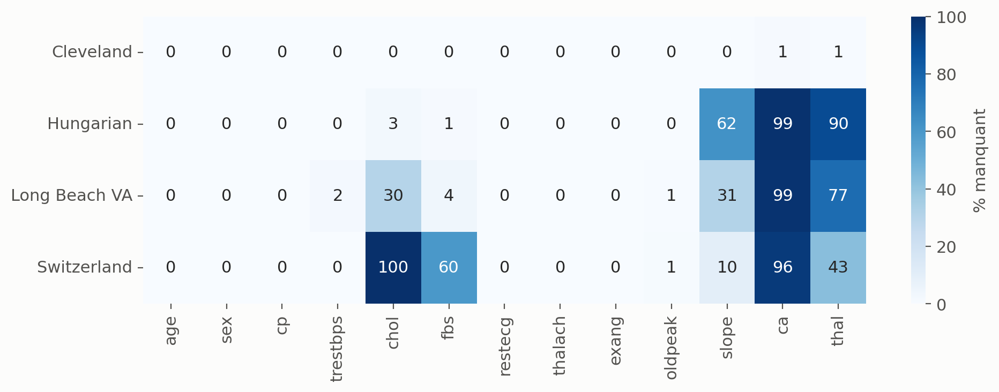
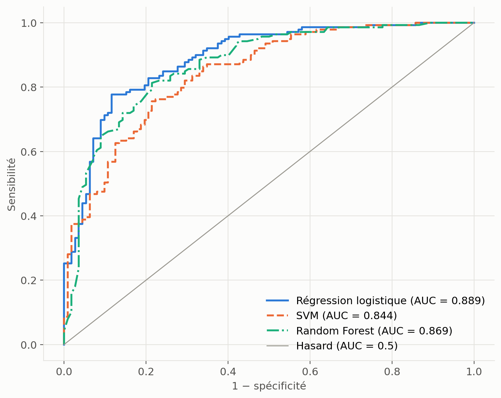
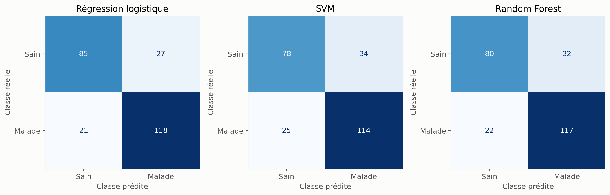
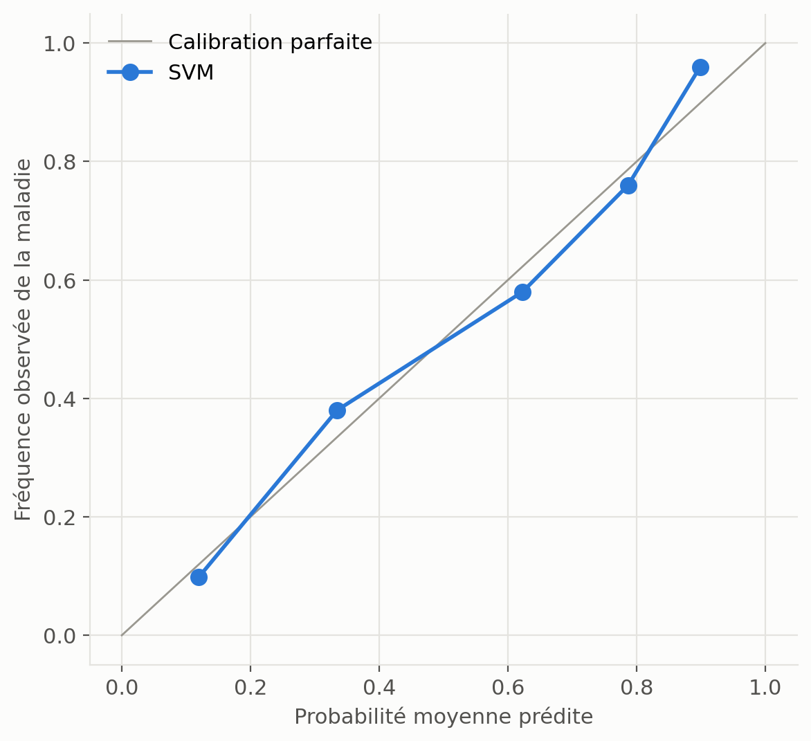
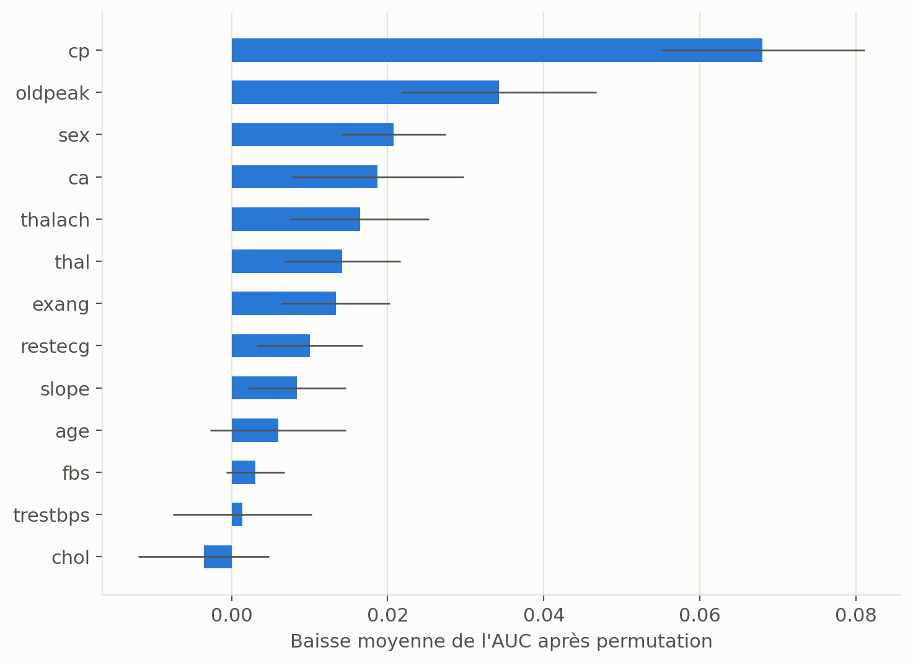
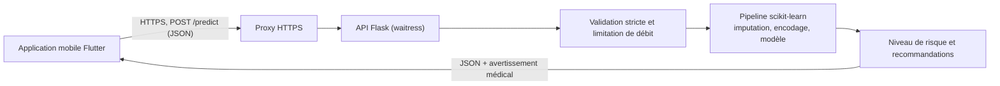

# CardioPredict : prédiction du risque cardiovasculaire

 

**FR.** Modèle de prédiction du risque de maladie coronarienne entraîné sur 834 patients de quatre centres (UCI Heart Disease), exposé par une API Flask sécurisée à une application mobile. Sur 251 patients de test, le modèle retenu atteint une sensibilité de 82,0 % et une AUC de 0,844. La validation entre centres montre les limites de son transfert à de nouvelles populations.

**EN.** A coronary disease risk model trained on 834 patients from four centres (UCI Heart Disease) and served to a mobile app through a hardened Flask API. On 251 held-out patients, the selected model reaches 82.0% sensitivity and 0.844 AUC. Leave-one-centre-out validation documents how far it transfers to new populations.

> **Avertissement médical.** Outil d'aide à la décision à visée de recherche. Il ne pose pas de diagnostic et ne remplace pas l'avis d'un professionnel de santé.

## Sommaire

[Contexte](#contexte) · [Objectifs](#objectifs) · [Données](#données) · [Méthodologie](#méthodologie) · [Résultats](#résultats) · [Écart avec le mémoire](#écart-avec-le-mémoire) · [Architecture](#architecture) · [Installation](#installation-et-utilisation) · [API](#documentation-de-lapi) · [Structure](#structure-du-dépôt) · [Limites](#limites-et-perspectives) · [Auteur](#auteur) · [Citation](#citation-et-licence)

## Contexte

Les maladies cardiovasculaires causent environ 31 % des décès annuels dans le monde, soit près de 18 millions de morts (OMS, 2020), et constituent un problème de santé publique croissant au Bénin. Un stage au service de cardiologie du CNHU-HKM de Cotonou a mis en évidence trois contraintes : accès limité aux examens biologiques, dossiers majoritairement sur papier et quasi-absence d'outils numériques d'aide à la décision.

CardioPredict explore ce que peut apporter un outil de dépistage accessible depuis un téléphone. Ses données d'entraînement ne sont pas africaines : la plateforme eCardio du CNHU-HKM ouvre la voie à la constitution de données béninoises, indispensables pour adapter et valider le modèle localement.

## Objectifs

1. Construire un jeu de données clinique combiné et documenté à partir de sources publiques.
2. Comparer régression logistique, SVM et Random Forest avec une méthode sans fuite de données.
3. Donner la priorité à la sensibilité, car manquer un patient malade est l'erreur la plus grave.
4. Mesurer la stabilité, le transfert entre centres, la calibration et le rôle des variables.
5. Exposer le modèle à l'application mobile par une API sécurisée, adaptée à des données de santé.

## Données

**Source.** [UCI Heart Disease](https://archive.ics.uci.edu/dataset/45/heart+disease), fichiers `processed` de quatre centres, licence CC BY 4.0.

| Centre | Patients retenus | Part de malades |
|---|---:|---:|
| Cleveland | 303 | 45,9 % |
| Hongrie | 272 | 37,9 % |
| Suisse | 117 | 93,2 % |
| Long Beach VA | 142 | 78,9 % |
| **Total** | **834** | **55,5 %** |

| Variable | Signification | Unité ou valeurs |
|---|---|---|
| `age` | Âge | années |
| `sex` | Sexe | 0 = femme, 1 = homme |
| `cp` | Type de douleur thoracique | 0 = typique, 1 = atypique, 2 = non angineuse, 3 = asymptomatique |
| `trestbps` | Pression artérielle au repos | mmHg |
| `chol` | Cholestérol sérique | mg/dL |
| `fbs` | Glycémie à jeun > 120 mg/dL | 0 = non, 1 = oui |
| `restecg` | ECG au repos | 0 = normal, 1 = anomalie ST-T, 2 = hypertrophie ventriculaire gauche |
| `thalach` | Fréquence cardiaque maximale | bpm |
| `exang` | Angine à l'effort | 0 = non, 1 = oui |
| `oldpeak` | Sous-décalage du segment ST | mm |
| `slope` | Pente du segment ST | 0 = ascendante, 1 = plate, 2 = descendante |
| `ca` | Vaisseaux principaux colorés en fluoroscopie | 0 à 3 |
| `thal` | Scintigraphie au thallium | 0 = normal, 1 = défaut fixe, 2 = défaut réversible |
| `target` | Diagnostic (`num` ≥ 1) | 0 = sain, 1 = malade |

**Nettoyage** ([src/build_dataset.py](src/build_dataset.py)) :

- `?` et `-9` sont lus comme valeurs manquantes.
- Les 86 patients auxquels il manque au moins 4 variables sur 13 sont écartés (920 → 834).
- `chol = 0` et `trestbps = 0`, physiologiquement impossibles, deviennent des valeurs manquantes.
- Le fichier [heart_uci_combined.csv](data/processed/heart_uci_combined.csv) reste **non imputé** ; la colonne `centre` sert uniquement à la validation par centre.

Les données manquantes sont massives et dépendent du centre : `ca` manque pour 62,9 % des patients et `thal` pour 48,6 %.



Ce jeu est publié sur [Kaggle](https://www.kaggle.com/datasets/abdoulwakiloutiga/uci-heart-disease-clean-combined-dataset) et décrit dans sa [fiche](data/README.md). La version 1 contient l'ancienne imputation décrite plus bas ; la version 2 reprend le fichier de ce dépôt, non imputé.

## Méthodologie

**Prétraitement.** Un `Pipeline` scikit-learn unique enchaîne médiane et normalisation (variables numériques et `ca`), mode et encodage one-hot (`cp`, `restecg`, `slope`, `thal`), mode (variables binaires). Il est réajusté dans chaque pli, sans accès à la cible.

**Découpage.** 70 % / 30 % stratifié, `random_state=42` : 583 patients d'entraînement, 251 de test (139 malades, 112 sains).

**Modèles.** Régression logistique, SVM à noyau RBF et Random Forest, chacun optimisé par recherche sur grille (12 à 24 configurations) avec option de pondération des classes.

**Règle de sélection.** Définie avant l'évaluation finale et appliquée sur le seul jeu d'entraînement, en validation croisée stratifiée à 5 plis :

1. écarter les configurations dont la spécificité moyenne est inférieure à 0,70 ;
2. retenir la sensibilité moyenne la plus élevée ;
3. départager à l'AUC.

**Pourquoi la sensibilité.** Un faux négatif renvoie un patient malade chez lui sans suivi, alors qu'un faux positif conduit à un examen complémentaire. Le plancher de spécificité empêche la solution dégénérée qui classerait tout le monde comme malade.

**Métriques.** Matrice de confusion, accuracy, AUC, sensibilité, spécificité et score de Brier, avec intervalles de confiance à 95 % par bootstrap (2 000 tirages). Le seuil de décision est 0,5 partout, y compris dans l'API.

## Résultats

Toutes les valeurs ci-dessous sont produites par le code du dépôt (dossier [reports/](reports/)).

### Sélection sur le jeu d'entraînement

| Modèle | Sensibilité (5 plis) | Spécificité | AUC | Paramètres retenus |
|---|---:|---:|---:|---|
| **SVM (retenu)** | **86,75 ± 4,39 %** | 73,75 ± 0,84 % | 0,849 ± 0,032 | C=10, gamma=scale |
| Random Forest | 86,43 ± 2,61 % | 73,75 ± 3,32 % | 0,885 ± 0,022 | 100 arbres, profondeur libre, classes pondérées |
| Régression logistique | 84,89 ± 6,53 % | 77,99 ± 5,09 % | 0,880 ± 0,030 | C=0,1 |

### Évaluation finale sur 251 patients

| Modèle | Accuracy [IC 95 %] | AUC [IC 95 %] | Sensibilité [IC 95 %] | Spécificité [IC 95 %] | Brier | TN / FP / FN / TP |
|---|---|---|---|---|---:|---|
| **SVM (retenu)** | 76,49 % [70,9 ; 81,7] | 0,844 [0,794 ; 0,890] | 82,01 % [75,4 ; 88,2] | 69,64 % [60,8 ; 78,0] | 0,160 | 78 / 34 / 25 / 114 |
| Random Forest | 78,49 % [73,3 ; 83,7] | 0,869 [0,819 ; 0,913] | 84,17 % [77,7 ; 90,0] | 71,43 % [62,9 ; 80,0] | 0,144 | 80 / 32 / 22 / 117 |
| Régression logistique | 80,88 % [76,1 ; 85,7] | 0,889 [0,844 ; 0,929] | 84,89 % [78,5 ; 90,6] | 75,89 % [67,6 ; 83,7] | 0,134 | 85 / 27 / 21 / 118 |

**Lecture.** La règle fixée à l'avance a retenu le SVM, pour un écart de sensibilité minime en validation croisée. Sur le test, le SVM obtient les scores les plus bas, avec des intervalles de confiance largement chevauchants. Je n'ai pas changé de modèle au vu de ce résultat : choisir d'après le jeu de test invaliderait cette évaluation.

Ce jeu de test n'a joué aucun rôle dans les choix de modélisation présentés ici. Il avait toutefois déjà été utilisé dans le mémoire et lors de l'audit qui a révélé la fuite : il n'est donc pas totalement vierge, et une validation externe reste nécessaire.





### Stabilité : validation croisée imbriquée à 10 plis (834 patients)

L'optimisation est refaite à l'intérieur de chaque pli (moyenne ± écart-type).

| Modèle | Accuracy | AUC | Sensibilité | Spécificité |
|---|---:|---:|---:|---:|
| SVM | 80,80 ± 5,14 % | 0,877 ± 0,046 | 87,02 ± 5,16 % | 73,09 ± 7,79 % |
| Random Forest | 81,05 ± 3,64 % | 0,880 ± 0,031 | 85,52 ± 4,24 % | 75,50 ± 6,86 % |
| Régression logistique | 79,85 ± 4,86 % | 0,880 ± 0,036 | 82,71 ± 5,32 % | 76,29 ± 7,57 % |

Les trois familles sont indiscernables compte tenu de la dispersion. Elles se situent autour de 80 % d'accuracy et 0,88 d'AUC.

### Transfert : entraînement sur 3 centres, test sur le 4ᵉ

| Centre testé | Patients (sains) | SVM : sens. | SVM : spéc. | SVM : AUC | R. logistique : AUC | R. Forest : AUC |
|---|---:|---:|---:|---:|---:|---:|
| Cleveland | 303 (164) | 87,05 % | 61,59 % | 0,870 | 0,875 | 0,849 |
| Hongrie | 272 (169) | 74,76 % | 81,07 % | 0,854 | 0,884 | 0,858 |
| Suisse | 117 (8) | 70,64 % | 75,00 % | 0,748 | 0,749 | 0,787 |
| Long Beach VA | 142 (30) | 91,96 % | 26,67 % | 0,655 | 0,677 | 0,627 |

La performance chute nettement à Long Beach VA, avec une spécificité de 26,67 %, et les résultats suisses reposent sur seulement 8 patients sains. Le modèle ne doit donc pas être considéré comme transférable sans validation locale.

### Calibration

Les probabilités du SVM suivent globalement les fréquences observées (5 groupes de 50 patients environ ; Brier 0,160) : 0,12 prédit pour 0,10 observé, 0,62 pour 0,58, 0,90 pour 0,96. Cette vérification porte sur un seul échantillon.



### Importance des variables

La permutation mesure la perte d'AUC du modèle retenu sur le test. Les variables les plus influentes sont `cp` (0,068), `oldpeak` (0,034), `sex` (0,021), `ca` (0,019) et `thalach` (0,017). Cette mesure décrit le modèle ; elle n'établit pas de lien de causalité.



## Écart avec le mémoire

Les chiffres du mémoire se reproduisent à l'identique au commit `5c26eb6`. Une revue postérieure à la soutenance a établi qu'ils sont surestimés.

| Random Forest, 251 patients de test | Accuracy | AUC | Sensibilité | Spécificité |
|---|---:|---:|---:|---:|
| Mémoire | 92,83 % | 0,9796 | 94,96 % | 90,18 % |
| Ce dépôt | 78,49 % | 0,8694 | 84,17 % | 71,43 % |
| *Modèle retenu ici : SVM* | *76,49 %* | *0,8442* | *82,01 %* | *69,64 %* |

**Cause 1 : fuite de données par imputation.** L'ancien script remplaçait les valeurs manquantes par la médiane de la **classe du patient**, avant le découpage. `ca` manquant pour 525 patients sur 834, ces patients recevaient 0 s'ils étaient sains et 1 s'ils étaient malades : pour eux, la variable révélait le diagnostic (corrélation de 1,0, contre 0,456 sur les valeurs mesurées).

**Cause 2 : zéros non traités.** 157 patients avaient `chol = 0`, un code d'absence de mesure concentré à Long Beach VA et en Suisse (30,2 % des malades, 4,6 % des sains), ce qui renseignait le modèle sur le centre d'origine.

**Autres changements.** Le choix du modèle se faisait sur le jeu de test et seul le Random Forest était optimisé. La cohorte de 834 patients et le découpage restent identiques, ce qui rend la comparaison directe.

## Architecture



## Installation et utilisation

Prérequis : Python 3.12.

```bash
python -m venv venv
source venv/bin/activate        # Windows : venv\Scripts\activate
pip install -r requirements-dev.txt
```

**Reproduire les résultats**, depuis la racine du dépôt :

```bash
python -m src.run_pipeline                     # données, exploration, sélection, test
python -m src.run_pipeline --with-robustness   # ajoute validation imbriquée et par centre (environ 30 min)
pytest                                         # 41 tests
```

**Lancer l'API** :

```bash
cp .env.example .env                           # facultatif
waitress-serve --listen=127.0.0.1:5000 api.app:app
```

En production, l'API reste derrière un proxy (Nginx par exemple) qui impose HTTPS, avec `CARDIO_TRUSTED_PROXIES=1`. Pour tester depuis un émulateur Android, écouter sur `--listen=0.0.0.0:5000` sur un réseau de développement uniquement. Pour Flutter Web, déclarer l'origine exacte dans `CARDIO_CORS_ORIGINS`.

**Exemple de requête** :

```bash
curl -X POST http://127.0.0.1:5000/predict \
  -H "Content-Type: application/json" \
  -d '{"age":55,"sex":1,"cp":3,"trestbps":140,"chol":250,"fbs":0,"restecg":0,"thalach":130,"exang":1,"oldpeak":1.5,"slope":1,"ca":1,"thal":2}'
```

**Réponse** (liste de recommandations abrégée) :

```json
{
  "success": true,
  "prediction": 1,
  "prediction_label": "Malade",
  "probability_disease": 0.9457,
  "probability_no_disease": 0.0543,
  "risk_level": 4,
  "risk_label": "Risque très élevé",
  "risk_description": "Risque très élevé selon le modèle. Consultation médicale urgente sous 48 h.",
  "recommendations": ["Tension élevée (140 mmHg) : consultez un médecin. ..."],
  "disclaimer": "Outil d'aide à la décision à visée de recherche : ce résultat n'est pas un diagnostic et ne remplace pas l'avis d'un professionnel de santé."
}
```

## Documentation de l'API

| Route | Méthode | Rôle |
|---|---|---|
| `/predict` | POST | Renvoie la prédiction, le niveau de risque et les recommandations |
| `/health` | GET | État du service et version du modèle |
| `/` | GET | Description du service et des encodages |

Les 13 champs sont obligatoires. Tout autre champ est refusé, comme les booléens, les chaînes et `null`.

| Champ | Type | Valeurs acceptées |
|---|---|---|
| `age` | entier | 18 à 120 |
| `sex`, `fbs`, `exang` | catégorie | 0, 1 |
| `cp`, `ca` | catégorie | 0, 1, 2, 3 |
| `restecg`, `slope`, `thal` | catégorie | 0, 1, 2 |
| `trestbps`, `thalach` | nombre | 50 à 250 |
| `chol` | nombre | 50 à 700 |
| `oldpeak` | nombre | −5 à 10 |

| Code | Signification |
|---|---|
| 200 | Prédiction effectuée |
| 400 | JSON ou champ invalide (`error` et liste `details`) |
| 404 / 405 | Route inconnue ou méthode non autorisée |
| 413 | Requête de plus de 4 Ko |
| 415 | Type de contenu différent de `application/json` |
| 429 | Limite dépassée (30 requêtes par minute par défaut) |
| 500 | Erreur interne, message générique |

Les réponses portent toutes le champ `disclaimer`. Les journaux contiennent uniquement l'heure, la méthode, la route, le statut et la durée.

## Structure du dépôt

```text
api/
  app.py               Routes, sécurité, chargement du modèle
  validation.py        Contrôle de chaque champ reçu
  recommendations.py   Niveaux de risque et conseils de prévention
data/
  raw/                 Fichiers UCI d'origine
  processed/           Jeu combiné, non imputé
models/
  cardio_pipeline.joblib   Pipeline complet retenu
  metadata.json            Version, date, colonnes, empreinte, métriques
reports/
  figures/             Figures de l'exploration et de l'évaluation
  *.json               Sélection, résultats de test, robustesse
src/
  config.py            Chemins et constantes partagés
  build_dataset.py     Construction du jeu combiné
  preprocessing.py     Découpage et préprocesseur
  modeling.py          Candidats, métriques, règle de sélection
  eda.py               Analyse exploratoire
  train.py             Sélection sur le train et sauvegarde
  evaluate.py          Évaluation finale sur le test
  robustness.py        Validation imbriquée et par centre
  run_pipeline.py      Exécution de bout en bout
tests/                 Tests de l'API et non-régression scientifique
```

## Limites et perspectives

**Limites**

- Données historiques, non africaines : le modèle n'a pas été validé sur une population béninoise.
- Aucune validation clinique ni validation externe indépendante n'a été réalisée.
- `ca` et `thal` reposent sur une fluoroscopie et une scintigraphie, peu compatibles avec un dépistage simple ; l'API les exige, alors qu'elles sont absentes pour une grande partie des patients d'entraînement.
- Valeurs manquantes très dépendantes du centre, transfert limité entre populations, en particulier à Long Beach VA.
- Les niveaux de risque et les conseils affichés n'ont pas été validés par des cardiologues.

**Perspectives**

- Collecter des données béninoises via eCardio, puis réévaluer et réajuster le modèle.
- Mener une validation clinique prospective avec le service de cardiologie du CNHU-HKM.
- Étudier un modèle sans examens invasifs, plus adapté au dépistage.

## Avertissement médical

CardioPredict est un outil d'aide à la décision à visée de recherche. Il ne pose pas de diagnostic, ne prescrit aucun traitement et ne remplace pas l'avis d'un professionnel de santé. Il n'est pas certifié comme dispositif médical. En cas de symptômes, contactez un médecin ou les services d'urgence.

## Auteur

**Abdoul-Wakilou TIGA**
[abdoulwakiloutiga@gmail.com](mailto:abdoulwakiloutiga@gmail.com) · [GitHub](https://github.com/Abdoul-wakilou) · [LinkedIn](https://www.linkedin.com/in/abdoul-wakilou-tiga) · [Kaggle](https://www.kaggle.com/abdoulwakiloutiga) · [abdevfreelance.com](https://abdevfreelance.com)

Mémoire de Master en Génie Logiciel, IFRI, Université d'Abomey-Calavi, soutenu le 29 juillet 2026 : *Développement d'un modèle d'intelligence artificielle pour la prédiction du risque cardiovasculaire et son intégration dans une application mobile*. Encadrant : Dr (MA) Mêton Mêton Atindehou. Le mémoire est disponible sur demande auprès de l'auteur.

Application mobile associée : [cardio_predict_mobile_app](https://github.com/Abdoul-wakilou/cardio_predict_mobile_app).

## Citation et licence

Pour citer ce travail, voir [CITATION.cff](CITATION.cff).

```bibtex
@software{tiga_cardiopredict_2026,
  author = {TIGA, Abdoul-Wakilou},
  title  = {CardioPredict : modèle de prédiction du risque cardiovasculaire et API Flask},
  year   = {2026},
  url    = {https://github.com/Abdoul-wakilou/cardio_predict_model}
}
```

Code distribué sous [licence MIT](LICENSE), © 2026 Abdoul-Wakilou TIGA. Données UCI Heart Disease sous licence CC BY 4.0 (Janosi, Steinbrunn, Pfisterer et Detrano, 1988).
